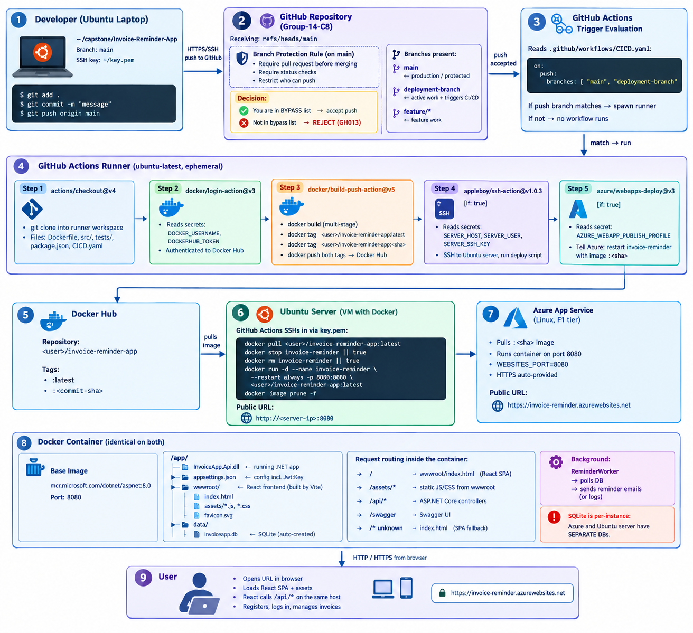
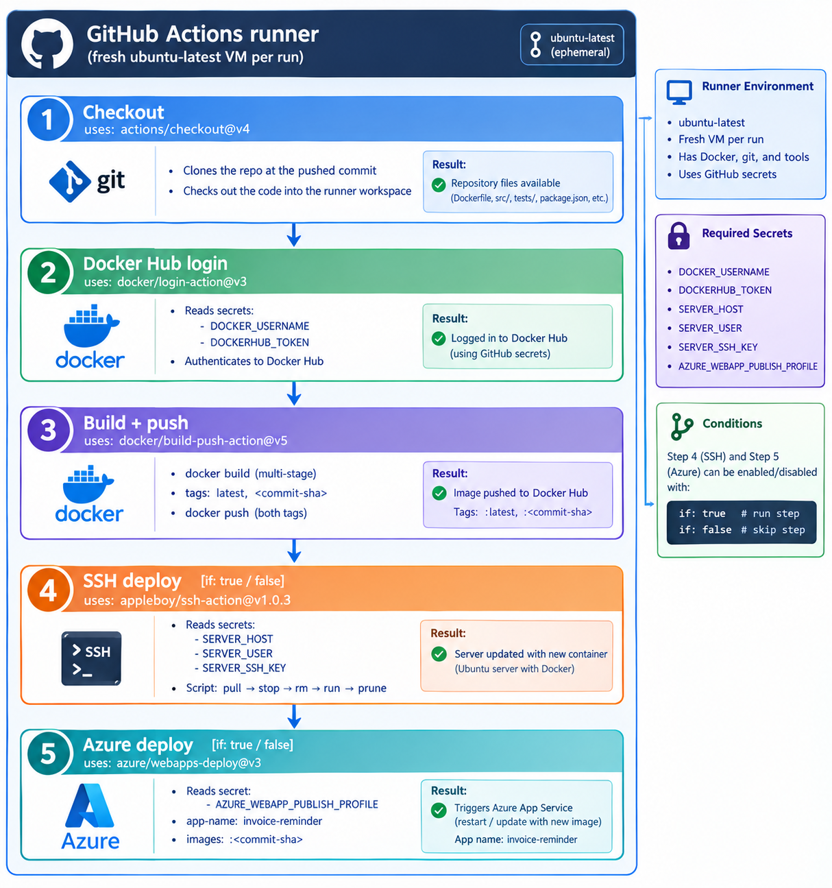

# Invoice & Payment-Reminder App

A web app for freelancers and small businesses to create invoices, track paid/unpaid
status, and send automatic payment reminders. Includes an admin dashboard showing
overdue totals.

## Overview
## Architecture



## Tech stack

## Run locally

The application can be run locally using Docker to match the production environment, or using the .NET SDK and Node.js for faster development iteration.

### With Docker

```
docker build -t invoice-reminder-app .
docker run -d --name invoice-reminder -p 8080:8080 -v invoice-data:/app/data invoice-reminder-app
```

The -v invoice-data:/app/data volume persists the SQLite database across container restarts.

### Without Docker

Run the API and frontend separately:

```
dotnet run --project src/InvoiceApp.Api
npm install && npm run dev
```

### Verification

The following were confirmed during local testing: the React frontend loads correctly, Swagger documents all endpoints, user registration and login work end-to-end with JWT issuance, the SQLite database is auto-created on first run via EnsureCreated(), and the background ReminderWorker starts without errors. Container logs show a clean startup with no connection or authentication failures.

## Environment variables

Environment variables are runtime configuration values injected into the container by the operating system, used instead of hardcoding secrets or environment-specific settings. In .NET, they override values in appsettings.json using a double-underscore convention (Jwt__Key maps to Jwt:Key). In this project, Azure App Service uses the WEBSITES_PORT=8080 variable to route traffic to the correct container port. This approach keeps sensitive values (JWT keys, database credentials) out of source control and allows the same Docker image to run in different environments without modification.

## CI/CD workflow

### The CI/CD pipeline is implemented with GitHub Actions in .github/workflows/CICD.yaml. It triggers automatically on every push to the main. The workflow runs five steps on a fresh Ubuntu runner:

1. **Checkout**: pulls the repo onto the runner

2. **Docker Hub login**: authenticates using GitHub Secrets

3. **Build and push**: builds the multi-stage Docker image and pushes it to Docker Hub with two tags (latest and the commit SHA)

4. **SSH deploy** — enabled; logs into the Ubuntu server on AWS EC2 and pulls the latest image

5. **Azure deploy**: tells Azure App Service to pull the newly built image and restart

The SHA tag is used for the Azure deployment to force Azure to pull a fresh image on every run, avoiding stale-cache issues with the latest tag. This setup achieves full automation: a single git push builds, ships, and deploys the application with no manual steps.




## Deployment (Azure App Service + Ubuntu Server on AWS EC2)

The application is deployed to two independent targets, both pulling the same Docker image from Docker Hub. This demonstrates the portability of the containerized application across a managed PaaS environment and a self-managed cloud VM.

### Azure App Service

The application is deployed to Azure App Service using the Docker Container publish method. Azure pulls the image from Docker Hub and runs it on a managed Linux host, exposing it via https://invoice-reminder-akbnezbxdvh4axg6.australiaeast-01.azurewebsites.net with automatically provisioned HTTPS. Deployment is authenticated via a Publish Profile (XML credentials) stored as a GitHub Secret. The WEBSITES_PORT=8080 application setting is configured in Azure to match the container's listening port.

**Regarding staging slots**: Azure App Service supports deployment slots for zero-downtime (blue-green) deployments — new versions can be deployed to a staging slot, tested, and then swapped into production instantly. However, slots require a Standard S1 or higher App Service Plan. This project uses the Free F1 tier for cost reasons, which does not support slots. As a result, deployments currently target the production slot directly, causing a brief restart during each release. For a production-grade setup, upgrading the tier and adding a slot-name: staging parameter to the webapps-deploy step would enable safe, zero-downtime releases.

### Ubuntu Server on AWS EC2

In addition to Azure, the same Docker image is deployed to a self-managed Ubuntu server running on an AWS EC2 instance. Deployment is handled by the same GitHub Actions workflow using appleboy/ssh-action. The workflow authenticates to the EC2 instance using an SSH key pair (key.pem) stored as a GitHub Secret. Once connected, the workflow runs a script that pulls the latest image from Docker Hub, stops and removes any previous container, starts a fresh container bound to port 8080 with --restart always, and prunes unused images. The application is accessible at http://54.167.46.5:8080/.

**Key characteristics**: port 8080 must be opened in the EC2 Security Group; the EC2 instance must have Docker installed and the SSH user must be a member of the docker group; and because both targets run independently, each maintains its own SQLite database — data is not shared between Azure and the EC2 instance. Unlike Azure, HTTPS is not provisioned automatically and would require a reverse proxy (e.g., Nginx + Let's Encrypt) for production use. The --restart always flag ensures the container restarts automatically on crash or EC2 reboot, providing resilience without external orchestration.

### Summary

Aspect	Azure App Service	Ubuntu Server (AWS EC2)
Host type	Managed PaaS	Self-managed VM (IaaS)
Deploy method	azure/webapps-deploy	appleboy/ssh-action
Auth	Publish Profile (XML)	SSH key (key.pem)
Image tag pulled	:<commit-sha>	:latest
HTTPS	Auto-provisioned	Not configured
Database	SQLite (per instance)	SQLite (per instance)
Both deployments are triggered by the same GitHub Actions workflow on every push to the deployment branch, ensuring version consistency across targets. The dual-target setup also provides a working demonstration that the application is not tied to any single cloud provider — a core benefit of containerization.

## Health check and monitoring
## Troubleshooting
